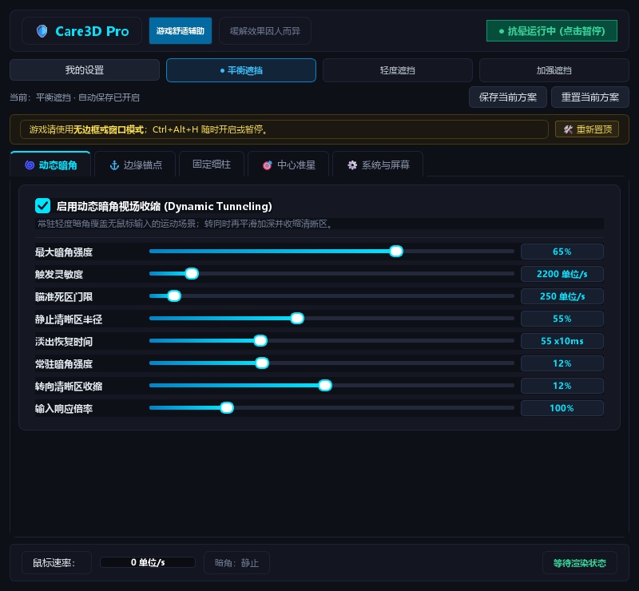

<div align="center">

# Care3D

**给游戏画面增加一层可调的视觉参照，尝试让 3D 游戏更舒适。**

A Windows desktop overlay for visual comfort in first- and third-person games.

[](#使用方法)
[](#从源码运行)
[](https://github.com/zh-984/Care3D/actions/workflows/windows.yml)
[](LICENSE)

[**下载 Windows 单文件 EXE**](https://github.com/zh-984/Care3D/releases/latest/download/Care3D_v2.exe) · [所有发布版本](https://github.com/zh-984/Care3D/releases) · [反馈问题](https://github.com/zh-984/Care3D/issues)

</div>

Care3D 主要面向在 Steam 等平台游玩 3D 游戏时容易感到不适的玩家。它通过一个独立、可点击穿透的透明窗口，提供动态暗角、固定锚点、四边三角形和细柱参照。参数可以实时调整，并按方案分别保存。

> **这是视觉舒适辅助工具，尚未经过人体对照实验或系统性的真实游戏效果验证。** 能否缓解晕 3D 因人、游戏和设备而异，不保证防晕或治疗效果。出现头晕、恶心等不适时，应停止游戏并休息。

## 界面预览



<details>
<summary>查看暗角与固定参照效果示意</summary>


以上图片由项目界面和绘图代码离屏生成，使用演示参数；参照示意的背景不是游戏截图。

</details>

## 可以做什么

| 功能 | 作用与行为 |
| --- | --- |
| 动态暗角 | 鼠标快速移动或手柄右摇杆转向时，平滑加深周边遮挡并缩小中央清晰区。 |
| 常驻轻度暗角 | 没有鼠标输入时也保留一层可调遮挡，可用于行走、载具或过场等场景。 |
| 边缘圆点锚点 | 屏幕四周的固定参照点，大小、数量、颜色、透明度及外光晕可调。 |
| 四边固定三角形 | 上、下、左、右边缘中点各一个，朝向中心；大小和颜色可调，位置及亮度不随转向变化。 |
| 四根固定细柱 | 横向四等分区域的中心各一根，即屏幕宽度的 **1/8、3/8、5/8、7/8** 处；宽度、高度、颜色和可见度可调。 |
| 可选中心参照 | 小圆点或细十字，默认关闭，可按需要单独开启。 |
| 独立保存方案 | “我的设置 / 平衡遮挡 / 轻度遮挡 / 加强遮挡”各自记忆参数，切换和重启后恢复。 |
| 游戏窗口绑定 | 选定游戏处于前台时显示，切到桌面时隐藏；覆盖层跟随游戏客户区。 |
| 鼠标与手柄输入 | 优先使用 Windows Raw Input，相对位移不受光标回中影响；可选读取 XInput 右摇杆。 |
| 全局开关与托盘 | `Ctrl + Alt + H` 随时开启或暂停；关闭设置窗口后继续驻留托盘。 |

所有复选框均有明确状态：**框内有对勾表示开启，空框表示关闭。**

## 使用方法

### 直接运行 EXE

1. 在 [Releases](https://github.com/zh-984/Care3D/releases) 下载 **`Care3D_v2.exe`**。
2. 双击运行，无需安装 Python。
3. 将游戏显示模式设为 **无边框全屏** 或 **窗口模式**。
4. 先从“轻度遮挡”或“平衡遮挡”开始，按需要调整。
5. 游戏中按 `Ctrl + Alt + H` 开启或暂停覆盖层。

**运行环境：Windows 10 / 11，64 位。** 传统独占全屏可能盖住桌面覆盖层；本项目目前不支持 macOS、Linux 或 Steam Deck 的 SteamOS 模式。

关闭控制面板会将其隐藏，程序仍在后台运行。打开电脑右下角托盘中的 Care3D 菜单，可以重新打开面板或退出程序。不要同时运行旧版和新版，以免两个覆盖层叠加变暗。

### 只对一个游戏生效

1. 先启动游戏，再进入 Care3D 的 **“系统与屏幕”** 页。
2. 点击 **“刷新窗口”**，选择游戏窗口。
3. 勾选 **“仅在选定游戏位于前台时显示，并跟随其窗口”**。

未绑定窗口时，覆盖层作用于选定的整块显示器。绑定后，锚点、三角形和细柱相对于游戏客户区固定。若游戏重启后窗口标题变化，或存在同名窗口，请重新选择并检查实际覆盖目标。

## 调整与保存参数

### 方案不会互相覆盖

- **自动保存**：滑块和开关实时生效，修改会自动写入当前方案；也可点击“保存当前方案”立即保存。
- **切换前先保存**：点“轻度”或“加强”时，会先记住当前修改，再恢复目标方案上次的参数。再次点击已选中的方案也不会重置。
- **保留旧设置**：升级前的参数会迁移到“我的设置”。
- **明确重置**：“重置当前方案”只影响当前方案；“重置所有方案与系统设置”才会清空全部方案，均需确认。

暗角、圆点、三角形、细柱、中心参照和输入响应倍率按方案保存；显示器、游戏窗口绑定、手柄开关、刷新上限和主开关属于共用的系统设置。

### 默认参数说明

这些数值是可调整的工程初始值，不是经过效果实验验证的医学建议。

| 参数 | 平衡方案默认值 | 含义 |
| --- | --- | --- |
| 常驻暗角 | 12% | 停止转向后保留的周边遮挡，设为 0 可关闭常驻暗角。 |
| 最大暗角 | 65% | 快速转向时的最大周边不透明度，中央区域仍透明。 |
| 静止清晰区半径 | 55% | 透明椭圆半轴占覆盖区域对应半宽、半高的比例。 |
| 转向清晰区收缩 | 12% | 快速转向时将清晰区半径从 55% 收缩到约 43%。 |
| 淡出恢复时间 | 0.55 秒 | 恢复动画的时间尺度，不是严格完成时间。 |
| 触发灵敏度 / 死区 | 2200 / 250 | 输入速度阈值，**不是游戏镜头的角速度**。 |
| 输入响应倍率 | 100% | 只改变覆盖层响应，不改变游戏内鼠标灵敏度。 |
| 四边三角形 | 默认关闭，16 px | 大小可调 6–64 逻辑像素，颜色可选。 |
| 四根细柱 | 默认关闭，宽 2 px | 高度占 60%、可见度 25%；建议先保持较细、较淡。 |
| 动态刷新上限 | 60 FPS | 动态重绘上限；静止后暂停动画定时器，仍保留输入与窗口状态检查。 |

Raw Input 的速度单位是鼠标原始计数/秒；回退模式使用光标像素/秒，两者阈值不能视为等价。鼠标 DPI、游戏内灵敏度和开镜倍率会影响响应的适合程度，可以调整输入响应倍率和阈值。界面中的 `px` 是随系统显示缩放的逻辑像素。

XInput 支持原生兼容手柄及 Steam Input 的 XInput 输出。其他手柄模式、自动镜头运动和过场不一定能触发动态增强，可以使用常驻暗角作为补充。加强遮挡会损失更多周边信息，不能理解为“治疗重度症状”。

## 从源码运行

需要 Windows 和 Python 3.10 或以上版本。

```powershell
git clone https://github.com/zh-984/Care3D.git
cd Care3D
python -m venv .venv
.\.venv\Scripts\python.exe -m pip install -r requirements.txt
.\.venv\Scripts\python.exe main.py
```

依赖为 PyQt6、pywin32 和 pynput。无需修改 PowerShell 执行策略，直接使用虚拟环境中的 Python 即可。

## 构建与测试

```powershell
.\.venv\Scripts\python.exe -m pip install -r requirements-dev.txt
.\.venv\Scripts\python.exe -m unittest discover -s tests -v
.\.venv\Scripts\python.exe build.py
.\.venv\Scripts\python.exe tools/smoke_test_exe.py
```

单文件程序输出到 **`dist/Care3D_v2.exe`**。运行中的 EXE 不能被 Windows 覆盖，重新构建前请先从托盘退出已有实例。

`requirements-dev.txt` 固定本次发布验证过的主要运行库和打包工具版本。Windows CI 会运行测试、构建 EXE，并检查打包程序的初始化与退出；构建结果可在对应 Actions 运行的 Artifacts 中下载。测试覆盖配置校验、方案切换与保存、Raw Input 消息分发、窗口焦点、动画休眠，以及三角形、细柱等绘制行为。打包检查使用不显示界面的 `--smoke-test`，不能替代真实输入与游戏测试；工程测试通过不等于缓解效果或反作弊兼容性已得到验证。

## 配置与日志

| 文件 | 路径 |
| --- | --- |
| 用户配置 | `%LOCALAPPDATA%\Care3D\config.json` |
| 运行日志 | `%LOCALAPPDATA%\Care3D\care3d.log` |

配置采用原子写入并校验参数，日志会轮转。首次运行且用户配置不存在时，可以从源码根目录或 EXE 旁的旧 `config.json` 迁移；后续以用户目录配置为准。个人配置、运行日志、缓存和构建产物不纳入源码仓库。

## 常见问题

<details>
<summary>程序打开了，游戏中却看不到覆盖层？</summary>

先确认主开关已开启，游戏使用无边框或窗口模式，并选择了正确的显示器。若绑定了游戏窗口，要确保目标窗口已获得焦点。切屏后可以尝试“重新置顶”。独占全屏及部分受保护的显示路径不保证兼容。

</details>

<details>
<summary>点轻度或加强方案后，我的参数去哪里了？</summary>

每个方案单独保存。点击修改过的原方案即可恢复；升级前的参数在“我的设置”。只有明确执行重置才会恢复默认值。如果状态显示“保存失败”，请检查配置目录写入权限。

</details>

<details>
<summary>为什么鼠标或手柄转向时暗角反应不合适？</summary>

在“系统与屏幕”页检查输入检测状态。Raw Input 不可用时会显示光标回退提示，锁定鼠标的游戏中可能不准确。尝试调整输入倍率、触发阈值；手柄需要启用 XInput 增强。鼠标位移和摇杆输入仅是镜头运动的代理，不能反映所有画面运动。

</details>

<details>
<summary>透明覆盖层会影响性能吗？</summary>

动态绘制与 Windows 桌面合成都有开销。程序会缓存遮罩、限制刷新率，并在静止后停止动画定时器，但不承诺“零 CPU”或“完全不影响帧率”。实际开销取决于分辨率、刷新设置、显示模式和设备。

</details>

## 原理与使用边界

动态暗角借鉴周边视野限制研究，例如 [Fernandes & Feiner（2016）](https://www.cs.columbia.edu/2016/combating-vr-sickness/combating-vr-sickness.pdf)。这类研究主要针对 VR 场景，不能直接证明桌面游戏覆盖层有相同效果。

Care3D 不修改游戏的渲染 FOV，不稳定游戏镜头，不自动改变画质，也不检测恶心程度。它不会解决所有导致游戏不适的问题。

程序使用独立的点击穿透窗口，不读写游戏内存、不注入游戏图形管线、不修改游戏文件、不发送模拟键鼠。**这不等于所有游戏都允许覆盖层。** 额外准星、覆盖层等规则请以游戏官方要求为准；可参考 [BattlEye FAQ](https://www.battleye.com/support/faq/)。本项目不保证零处罚风险。

## 项目结构

```text
Care3D/
├── main.py                     # 生命周期、托盘与快捷键调度
├── core/
│   ├── config.py               # 参数校验、独立方案、持久化
│   ├── raw_input.py            # Windows 相对鼠标消息
│   ├── mouse_tracker.py        # 位移累加与速度平滑
│   ├── gamepad.py              # XInput 右摇杆读取
│   ├── hotkey_manager.py       # 全局快捷键
│   └── win_utils.py            # 穿透样式、窗口与显示器几何
├── ui/                         # 设置面板、覆盖层和托盘
├── tests/                      # 回归测试
├── docs/images/                # 不含个人桌面内容的文档图片
├── tools/render_readme_images.py
├── Care3D_v2.spec               # 可移植的 PyInstaller 配置
├── build.py                    # 单文件 EXE 构建入口
└── .github/workflows/windows.yml
```

欢迎通过 [Issues](https://github.com/zh-984/Care3D/issues) 提交问题。描述 Windows 版本、游戏显示模式、分辨率/缩放、输入方式和复现步骤，会更便于排查；分享截图或日志前请去除个人信息。

## 许可证

项目源码采用 [MIT License](LICENSE)。第三方依赖遵循各自的许可证，包括 PyQt6 的 GPLv3 / 商业许可；如需再分发程序，请一并确认依赖的许可要求。
